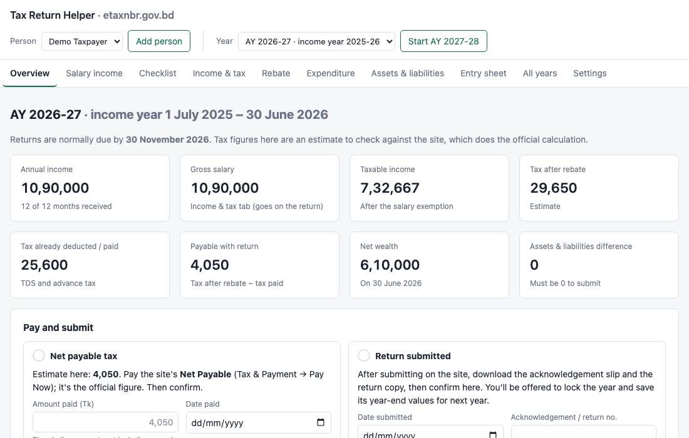

# Tax Return Helper (etaxnbr.gov.bd)

A local web app for preparing your Bangladesh income tax e-return on [etaxnbr.gov.bd](https://etaxnbr.gov.bd). You enter your income, investments, expenses, assets and liabilities in one place. The app estimates your tax and checks that your assets and liabilities balance the way the website requires. Then you type the figures into the website from a field-by-field entry sheet.

*The screenshot shows a made-up sample taxpayer.*

> **Your data stays on your computer.** The app runs on your own machine, is only reachable from that machine, and saves everything as plain files in its `data` folder. It needs no account and no internet connection, and it doesn't send your figures anywhere.

> **The figures are estimates.** The website does the official calculation. Check your tax against its **Tax & Payment** page before you pay or submit. This project isn't affiliated with the National Board of Revenue.

## What it does

- **Salary income:** enter each month's payslip as it arrives, totals so far, or the whole year at once. Months you haven't received yet are projected, so you can see your tax position, and the TDS still needed, at any point in the year.
- **Income & tax:** salary components and the salary exemption, other income (bank interest, DPS profit and so on), tax deducted at source and advance tax, with the tax worked out slab by slab.
- **Rebate:** life insurance, DPS, provident fund, savings certificates, shares and other investments, with the caps applied.
- **Expenditure:** the website's expenditure rows, in the same order and wording.
- **Assets & liabilities:** opening and closing values for each item, a check that the difference is 0, and a **Balance it** helper to close any gap.
- **Entry sheet:** every figure to type into the website, in the website's order, with copy buttons and tick-boxes.
- **Pay and submit:** record the tax you paid with the return and the submission, then lock the year.
- **Checklist:** documents to gather and steps to follow. Mark anything that doesn't apply to you as N/A.
- **Several years:** **Start next year** carries over assets, liabilities, policies and categories. **All years** shows key figures side by side.
- **Several people:** keep separate returns for, say, you and your spouse.
- **Import a filed return (PDF):** record a year you filed before you used the app, from the return's PDF. See [Importing documents](#importing-documents).
- **Import a monthly tax card (PDF):** fill a month on the Salary income tab from your employer's tax card. This currently reads the accordHRM payroll format.
- **Export:** download a year, or the all-years summary, as CSV.

## Running it

The app needs **Python 3.10 or newer** and nothing else: there are no packages to install. Alternatively you can run it with Docker.

First, get the code: on GitHub, click **Code → Download ZIP** and unzip it, or clone the repository with git.

### macOS

Double-click **`Start Tax Helper.command`**, or open Terminal in the folder and run:

    python3 server.py

Your browser opens http://127.0.0.1:8765. To stop the app, press Ctrl+C in the Terminal window or close it.

The first time you double-click the `.command` file, macOS may block it because it was downloaded. If that happens, right-click it, choose **Open**, then confirm.

### Windows

1. Install Python 3 from [python.org](https://www.python.org/downloads/). In the installer, tick **"Add python.exe to PATH"**.
2. In the app's folder, double-click **`server.py`**. Or open a terminal in the folder and run:

       py server.py

Your browser opens http://127.0.0.1:8765. To stop the app, close the terminal window.

### Linux

    python3 server.py

Then open http://127.0.0.1:8765.

### Docker (any system)

    docker compose up -d --build

Then open http://127.0.0.1:8765. The container starts again on its own whenever Docker is running. Your data stays in the `data` folder next to the app, which is mounted into the container. Stop it with `docker compose down`.

After updating the app's code, run the same `docker compose up -d --build` command again, then reload the page with a hard refresh (Ctrl+Shift+R, or Cmd+Shift+R on a Mac).

### Options

    python3 server.py --port 9000      # use a different port
    python3 server.py --no-browser     # don't open the browser

## Getting started

1. Open the app. It starts on the current assessment year.
2. Work through **Checklist → Gather documents**.
3. Fill in **Salary income**, then click **Send totals to Income & tax**.
4. Check **Income & tax** against your salary certificate and TDS certificate.
5. Fill in **Rebate**, **Expenditure** and **Assets & liabilities**. Use **Balance it** until the difference is 0.
6. Open the **Entry sheet** beside etaxnbr.gov.bd and type the figures in, ticking each one off.
7. After paying and submitting on the website, record both under **Overview → Pay and submit**, and lock the year.

Most tabs have a **Tips** section for the snags people commonly hit on the website.

### Tax rules

Each year keeps its own tax rules: tax-free amounts, slabs, rebate rates and caps, minimum tax. You can edit them in **Settings → Tax rules**. The built-in defaults follow the Finance Act at the time of writing, and they change with each budget, so check them every year. If your employer's tax card shows different rules, importing the card offers to copy them.

## Importing documents

Both imports read PDFs that contain text, like the ones websites and payroll systems produce. They can't read scans or photos. The PDF is read in memory and isn't kept.

**A filed return:** for a year you filed before you used the app.

1. On etaxnbr.gov.bd, open the filed return's **Return View**, print it, and choose **Save as PDF**.
2. In the app, go to **Settings → Record a past year from its return → Import a return PDF**.
3. Check the figures it found. It compares its own tax and balance with the return's. Then click **Save as that year**.

The year is saved and locked, with its year-end values, and the app offers to carry its opening values and the tax paid with the return into the following year.

**A monthly tax card:** on the **Salary income** tab, click **Import a tax card (PDF)** and choose the month's tax card from accordHRM. The app fills that month's salary items and TDS and marks the month received. It then compares your employer's projection and tax rules with the app's.

## Your data

- Each person's years are stored as `data/people/<person>/<assessment-year>.json`, for example `data/people/me/2026-2027.json`.
- Changes save automatically. Before each save, the previous version is backed up to `data/people/<person>/backups/<assessment-year>/`, at most one backup a minute, keeping the last 30.
- Removing a person in **Settings → Person** moves their folder to `data/removed/`; nothing is deleted.
- To move the app to another computer, copy the whole folder, including `data`.
- Keep only one browser tab of the app open at a time. Two tabs can overwrite each other's changes.

The `data` folder is excluded from git, so your figures never end up in a commit.

## Contributing

Bug reports and pull requests are welcome. The app is deliberately dependency-free: a Python standard-library server (`server.py`), a small PDF text reader (`pdftext.py`), and a single-page app in plain JavaScript (`static/`). Please don't attach real returns or tax documents to issues. Describe the problem, or use made-up figures.

## License

MIT, see [LICENSE](LICENSE).
